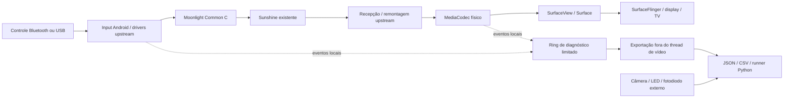

# Arquitetura

Base GPL-3.0 preservada: Moonlight Android 12.2, namespace Java/JNI `com.limelight`. Identidade instalável própria: `app.malhastream.debug` no diagnóstico e `app.malhastream.unofficial` na release. O histórico, licença e créditos upstream permanecem no Git.

`telemetry/` contém lógica Java pura com testes JVM e JaCoCo: buffer, intervalos, percentis e guard do experimento. O app contém bindings Android para inventário, callbacks, amostragem de recursos e compartilhamento. `benchmark/` analisa dados externos e prepara/coleta sessões por ADB autorizado. O CT compila e analisa; não emula desempenho da TV.

O diagnóstico é opt-in e existe somente na build debug. Eventos usam `System.nanoTime` no dispositivo; IDs de frame derivam do PTS usado pelo próprio renderer. Duração nativa de remontagem e duração reportada pelo host ficam como valores próprios, sem somar épocas de relógios. O tempo de evento Android do gamepad é comparado somente com `uptimeMillis` local.

O buffer guarda até 131072 eventos e informa quantos foram sobrescritos. Exportação, classificação e cálculo de percentis ocorrem fora do thread de vídeo. Perfetto/Trace é outra opção, desativada por padrão. A coleta pode perturbar o sistema; a matriz inclui A versus C para medir isso.

O experimento HEVC exige opt-in, modelo MiTV-AYFR0, API 34 e decoder exato `c2.amlogic.hevc.decoder`. Ele omite a chamada upstream de opções low latency, inclusive hints presentes nesse helper. Mantém seleção, SPS/PPS/CSD, RFI, recuperação, apresentação e controles upstream. Não altera flags Fire OS em outros dispositivos. `configured_format` e evento de aplicação permitem auditar a alteração efetiva.

Release normal mantém todas as políticas upstream; instrumentação e experimento estão compilados como desativados. A UI mantém navegação original para TV/D-pad e adiciona somente diagnóstico, exportação e identificação de build.

O CT usa Debian 13, instalação nativa, JDK 21 compatível, SDK 37.0, Build Tools 36 e NDK 29. GitHub CI usa JDK 17. Gradle vem do wrapper 9.7.1. A infraestrutura foi dimensionada por capacidade livre; configuração operacional e IP ficam no inventário local, sem publicar segredos ou configuração das cargas antigas.
